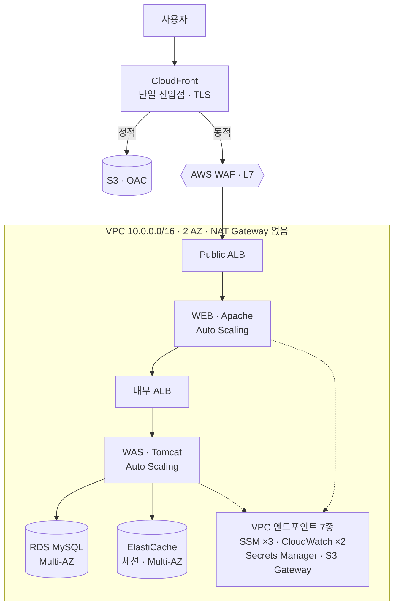
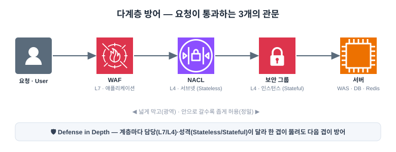
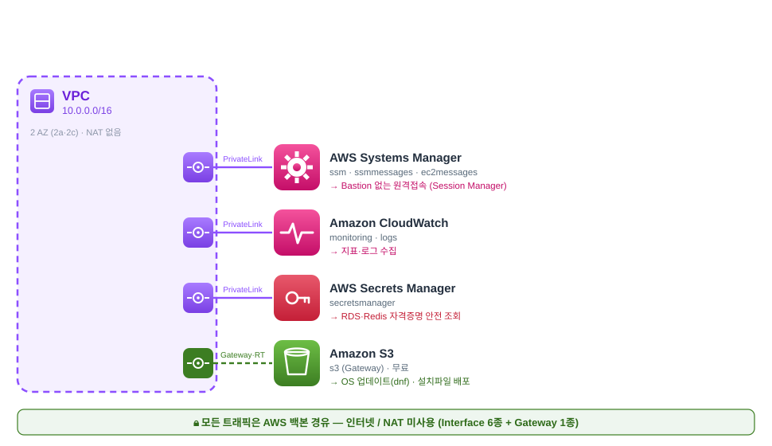
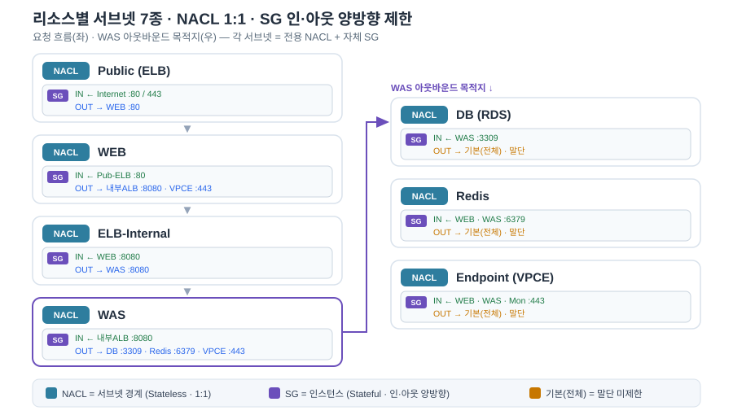

# AWS 3-Tier 웹 인프라 — NAT 없는 사설 네트워크와 다계층 방어

> KDT 베스핀글로벌 멀티클라우드 엔지니어 부트캠프 · 중간 프로젝트
> 2026.06.30 – 2026.07.14 (2주) · 5인 팀 · **역할: 팀장, 네트워크/보안 파트**

동물병원 관리 웹앱(Spring PetClinic)을 운영하기 위한 AWS 3-Tier 인프라를 설계·구축한 팀 프로젝트입니다.
이 저장소는 그중 **제가 맡은 네트워크·보안 파트의 설계 결정, 문제 해결, 회고**를 정리한 문서입니다.

> 📌 **구축 방식 안내** — 이 프로젝트는 AWS 콘솔에서 직접 구축했습니다. 따라서 이 저장소에는 인프라 코드가 없고,
> 설계 문서와 다이어그램만 담았습니다. 계정 ID·리소스 ID·도메인 등 식별값은 모두 제외했습니다.

---

## 한눈에 보기

| 항목 | 내용 |
|---|---|
| 목표 | 과제 필수 요소(Apache · Tomcat · RDS MySQL · mod_proxy)를 구축하고, AWS Well-Architected 6 Pillars 기준으로 설계 결정을 점검 |
| 팀 구성 | 네트워크/보안(본인) · WEB · WAS · DB · 모니터링 |
| 내 담당 | VPC·서브넷·NACL·라우팅, 보안그룹 체인, VPC 엔드포인트, SSM 접속, IAM, AWS WAF, 보안 관측(GuardDuty · CloudTrail · VPC Flow Logs) |
| 구축 결과 | VPC 1 · 서브넷 16 (2 AZ) · 커스텀 NACL 8 · **NAT Gateway 0** · VPC 엔드포인트 7 · WAF 규칙 6 |

## 전체 구조

| 구성 요소 | 역할 | 담당 |
|---|---|---|
| **VPC · 서브넷 · NACL · 보안그룹** | 계층 격리와 트래픽 경로 통제 | **본인** |
| **VPC 엔드포인트 · SSM** | 인터넷 없이 AWS 서비스 접근, Bastion 없는 운영 접속 | **본인** |
| **AWS WAF** | Public ALB 앞에서 SQLi · XSS · 악성 입력 · 과도 요청 차단 | **본인** |
| **GuardDuty · CloudTrail · Flow Logs** | 위협 탐지 · API 감사 · 네트워크 흐름 기록 | **본인** |
| CloudFront · Route 53 · ACM, WEB(Apache) | 진입점, 정적/동적 분리, 리버스 프록시 | WEB 파트 |
| 내부 ALB · WAS(Tomcat) | 애플리케이션 로직 | WAS 파트 |
| RDS MySQL · ElastiCache | 데이터 · 세션 저장, 자동 장애조치 | DB 파트 |
| CloudWatch · 알람 · Slack · Grafana | 지표 · 알람 · 대시보드 | 모니터링 파트 |

## 핵심 설계 결정

| # | 결정 | 이유 | 대가 |
|---|---|---|---|
| 1 | **티어별 /21 예약, 서브넷은 /24** | 부족한 자원은 IP가 아니라 서브넷 개수(VPC당 기본 200개). NACL을 예약 대역 단위로 걸어 서브넷을 늘려도 규칙 수정 0건 | 멘토 피드백: 사용 규모에 비해 대역이 큼 |
| 2 | **NAT Gateway 제거, VPC 엔드포인트 7종** | 프라이빗 서버의 인터넷 경로를 없애고 AWS 서비스 통신을 내부망으로 | 엔드포인트가 비용 1위(13일간 전체의 약 38%). 패키지 설치·OS 패치 부담이 WEB/WAS로 이동 |
| 3 | **Bastion 없이 SSM Session Manager** | 관리용 인바운드 포트 0개, SSH 키 관리 불필요, 접속 기록은 CloudTrail | — |
| 4 | **보안그룹 참조 체인 (인·아웃 양방향)** | 각 계층은 바로 앞 계층 보안그룹만 허용. 경로 계층은 아웃바운드도 다음 계층 포트로만 | 규칙 수가 늘고 변경 시 영향 범위 확인 필요 |
| 5 | **WAF는 WCU 한도 안에서 선별, Count로 먼저 관찰** | 관리형 규칙을 모두 켜면 1,500 WCU 한도 초과. 앱 특성(Java · DB · Linux)에 맞춰 1,305 WCU로 구성 | — |

자세한 내용: [네트워크 설계](docs/01-network-design.md) · [보안 설계](docs/02-security-design.md)

## 문제 해결 사례

| 사례 | 원인 | 조치 |
|---|---|---|
| **WAF가 사진 업로드를 차단** | 약 80KB 업로드가 관리형 규칙의 요청 본문 크기 제한(8KB)에 걸린 오탐 | 규칙 그룹 전체가 아니라 해당 하위 규칙만 Count로 전환해 기능 복구. 모든 경로의 크기 제한이 풀리는 문제를 짚어 경로 단위 예외 방안 설계 |
| **MFA 강제 정책 때문에 팀원 로그인 불가** | `Deny + NotAction` 정책 목록에 `iam:ChangePassword`가 빠짐 | NotAction 목록에 추가 |
| **S3 Gateway 엔드포인트 경유 시 NACL에서 멈춤** | 게이트웨이를 지나도 목적지는 S3 공인 IP. NACL은 프리픽스 리스트를 참조할 수 없음 | NACL 아웃바운드에 S3 대상 443 허용 |
| **Flow Logs가 켜져 있는데 로그 0바이트** | IAM 역할 신뢰 정책의 Principal 오류(`ec2` → `vpc-flow-logs`) | 신뢰 정책 수정 |

자세한 내용: [트러블슈팅](docs/03-troubleshooting.md)

## 검증

- 구축 후 AWS CLI로 실제 리소스를 조회해 설계 문서와 대조 — 서브넷 · NACL · 라우팅 · 엔드포인트 일치 확인
- WAF 로그 24시간분을 차단 규칙별로 분류해 오탐 원인 특정
- AWS Cost Explorer로 설계 결정의 실제 비용 확인
- 팀 차원에서 장애조치(Failover)와 Auto Scaling 동작을 영상으로 시연

## 한계와 회고

- 교육용 계정에서 2주간 운영한 환경이며 실제 사용자 트래픽은 없었습니다.
- CloudFront 우회 호출은 WAF로 **탐지만** 했고 차단하지 않았습니다. AWS Config와 엣지 WAF는 구축하지 못했습니다.
- **"켜져 있다"와 "동작한다"는 다르다** — 상태 표시가 아니라 실제 로그·지표가 생기는지까지 확인하는 습관이 생겼습니다.
- 다시 한다면 콘솔 수작업 대신 IaC로 관리하고, 대역 크기는 필요한 IP 수를 산정한 근거와 함께 제시하겠습니다.

자세한 내용: [회고](docs/04-retrospective.md)

## 다이어그램

| 다층 방어 (WAF → NACL → 보안그룹) | VPC 엔드포인트 (Full PrivateLink) |
|---|---|
|  |  |

> 위 그림은 요청이 지나는 7개 티어만 표시했습니다. 모니터링용 PUBLIC 티어를 포함하면 티어는 8개, 서브넷은 16개(2 AZ)입니다.

---

로그 분류, 실조회 대조, 문서 초안 작성에 AI 도구(Claude Code)를 보조로 사용했습니다. 설계 판단, 적용, 검토는 직접 했습니다.
