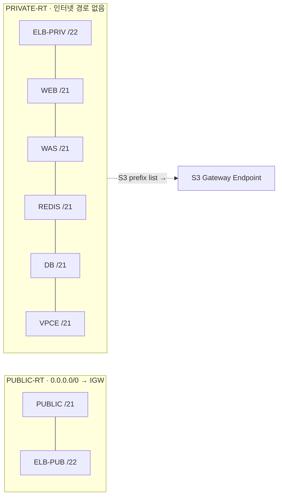
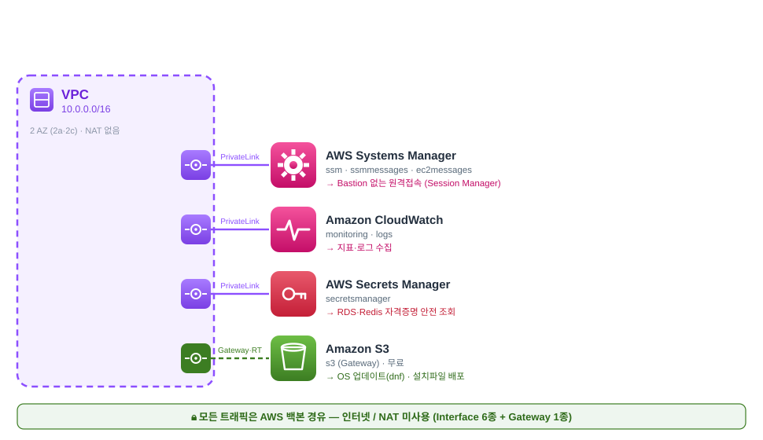

# 01. 네트워크 설계 — 티어 예약 /21, 서브넷 /24

[← README로](../README.md)

## 1. 풀어야 했던 질문

1. 티어나 가용영역이 늘어날 때 네트워크와 방화벽 규칙을 다시 손대지 않으려면 대역을 어떻게 나눠야 하는가?
2. 프라이빗 서버가 외부 인터넷에 의존하지 않고도 운영(접속 · 로그 · 비밀값 조회)될 수 있는가?

**제약**
- 2주 동안 5명이 각자 계층을 맡아 동시에 구축했습니다. 네트워크는 다른 파트가 올라갈 기반이라 가장 먼저 확정해야 했습니다.
- 처음 잡은 `192.168.0.0/16`에 대해 "가정용 공유기 대역이니 실무 표준으로 바꾸고 확장성을 고려하라"는 리뷰를 받아 구축 도중 재설계했습니다.
- AWS VPC의 CIDR은 최대 /16이고, 서브넷은 VPC당 기본 200개(소프트 리밋)입니다.

## 2. 핵심 판단 — 부족한 것은 IP가 아니라 서브넷 개수

`/16` VPC의 IP는 65,536개로 충분합니다. 반면 서브넷은 VPC당 기본 200개가 한도입니다.
그래서 이 설계에서 아껴야 할 자원은 **서브넷 개수**라고 보고, **"예약은 넓게, 배포는 작게"** 방식을 택했습니다.

- 3번째 옥텟을 기준으로 티어마다 `/21`(= `/24` 여덟 칸)을 예약합니다.
- 실제로는 가용영역마다 `/24` 하나씩만 배포합니다.
- **NACL 규칙은 개별 서브넷이 아니라 티어 예약 대역 단위로 등록합니다.** 같은 티어에 서브넷을 추가해도 NACL 규칙은 그대로입니다.

## 3. 대역 배치

| 티어 | 예약 대역 | 3옥텟 | 실제 서브넷 (2a · 2c) | 라우팅 |
|---|---|---|---|---|
| PUBLIC | 10.0.0.0/21 | 0–7 | 10.0.0.0/24 · 10.0.2.0/24 | PUBLIC-RT (IGW) |
| ELB-PUB | 10.0.8.0/22 | 8–11 | 10.0.8.0/24 · 10.0.10.0/24 | PUBLIC-RT (IGW) |
| ELB-PRIV | 10.0.12.0/22 | 12–15 | 10.0.12.0/24 · 10.0.14.0/24 | PRIVATE-RT |
| WEB | 10.0.16.0/21 | 16–23 | 10.0.16.0/24 · 10.0.18.0/24 | PRIVATE-RT |
| WAS | 10.0.32.0/21 | 32–39 | 10.0.32.0/24 · 10.0.34.0/24 | PRIVATE-RT |
| REDIS | 10.0.48.0/21 | 48–55 | 10.0.48.0/24 · 10.0.50.0/24 | PRIVATE-RT |
| DB | 10.0.64.0/21 | 64–71 | 10.0.64.0/24 · 10.0.66.0/24 | PRIVATE-RT |
| VPC-ENDPOINT | 10.0.80.0/21 | 80–87 | 10.0.80.0/24 · 10.0.82.0/24 | PRIVATE-RT |

**규칙**
- **AZ 슬롯**: 2a = +0, 2c = +2. 4개 AZ로 늘리면 2b = +1, 2d = +3을 씁니다. 대역이 겹치지 않습니다.
- **티어 사이 빈 구간**: 24–31, 40–47, 56–63, 72–79는 비워 두었고, 88–255는 새 티어용 예비입니다.
- **로드밸런서 분리**: 공개·내부 로드밸런서는 한 구역(8–15)을 `/22` 두 개로 나눠 NACL과 라우팅을 따로 두었습니다. 인터넷용 ALB와 내부 ALB를 네트워크 수준에서 격리하기 위해서입니다.
- **WEB은 프라이빗 서브넷**에 있습니다. 인터넷에서 오는 진입은 Public ALB만 받습니다.

## 4. 라우팅 — 프라이빗에는 인터넷 경로가 없다

PRIVATE-RT의 목적지는 두 가지뿐입니다.
- `10.0.0.0/16 → local`
- `S3 prefix list → S3 Gateway Endpoint`

`0.0.0.0/0` 경로가 없으므로 프라이빗 서버는 인터넷으로 나갈 수 없습니다.

## 5. NAT Gateway 대신 VPC 엔드포인트 7종 (Full PrivateLink)

프라이빗 서버도 SSM 접속, CloudWatch 로그 전송, 비밀값 조회 등으로 AWS 서비스와 통신해야 합니다.
NAT Gateway를 쓰면 이 트래픽이 인터넷 구간을 지나므로, 필요한 서비스마다 엔드포인트를 두었습니다.

| 엔드포인트 | 종류 | 없으면 생기는 일 (설계 시 영향 분석) |
|---|---|---|
| ssm · ssmmessages · ec2messages | Interface | 서버 접속(Session Manager)과 명령 전달 불가 |
| logs · monitoring | Interface | 서비스는 돌지만 로그 · 지표 · 알람이 멈춤 |
| secretsmanager | Interface | WAS 기동 시 DB 접속정보를 읽지 못해 Tomcat이 뜨지 않음 → **서비스 전체 장애** |
| s3 | Gateway | Amazon Linux 패키지 설치와 S3 업로드 불가 |

- 인터페이스 엔드포인트 6종은 VPC-ENDPOINT 티어 서브넷에 두고 Private DNS를 켰습니다.
- S3는 게이트웨이 엔드포인트로 PRIVATE-RT에 경로를 추가했습니다.

### 트레이드오프를 알고 선택했다

| 관점 | 결과 |
|---|---|
| 보안 | 프라이빗 서버의 인터넷 경로 제거 ✅ |
| 비용 | 인터페이스 엔드포인트는 AZ별 시간당 과금. 실측 결과 **VPC 엔드포인트가 프로젝트 비용 1위(13일간 전체의 약 38%)**. 이 결정은 비용 절감이 아니라 **보안을 위해 비용을 지불한 선택**이다 |
| 운영 | 외부 패키지 저장소를 쓸 수 없어 WEB 파트는 Apache를 소스 빌드해 이미지에 넣었고, OS 패치는 이미지 재빌드로만 가능해졌다. 네트워크 결정이 다른 파트의 운영 방식까지 바꿨다 |

## 6. 결과와 검증

- 서브넷 16개, 커스텀 NACL 8개, 라우팅 테이블 2개, IGW 1개, NAT Gateway 0개, VPC 엔드포인트 7개
- 구축 후 AWS CLI로 VPC · 서브넷 · NACL · 라우팅 · 엔드포인트를 조회해 설계 문서와 대조했고, 모두 일치함을 확인했습니다.
- RDS · Redis 서브넷 그룹은 DB · REDIS 티어 서브넷으로, 두 ALB는 ELB-PUB · ELB-PRIV 서브넷에 배치하도록 다른 파트와 맞췄습니다.

## 7. 남은 과제

- 멘토 피드백: **"사용 규모에 비해 CIDR이 크다."** 확장 여유를 근거로 들었지만, 필요한 IP 수를 숫자로 산정해 보여주지는 못했습니다.
- `10.0.0.0/16`은 온프레미스에서도 흔히 쓰는 대역이라 하이브리드 연결 시 충돌 위험이 있습니다. 다시 한다면 조직 단위 CIDR 배분 계획을 먼저 정하고 덜 흔한 대역을 고르겠습니다.
