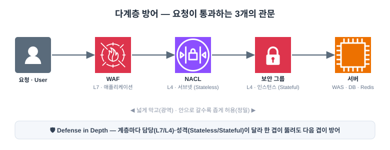
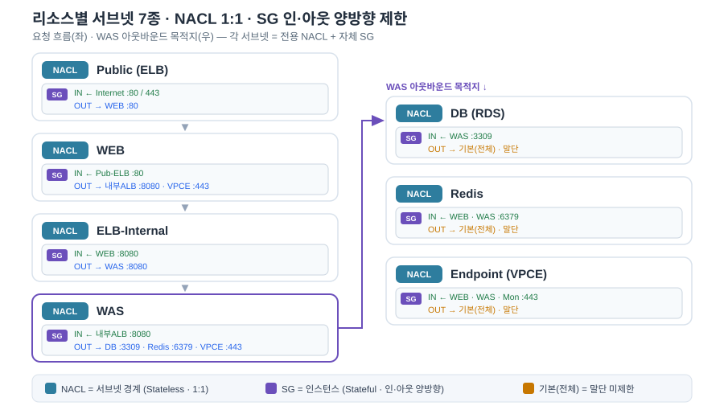
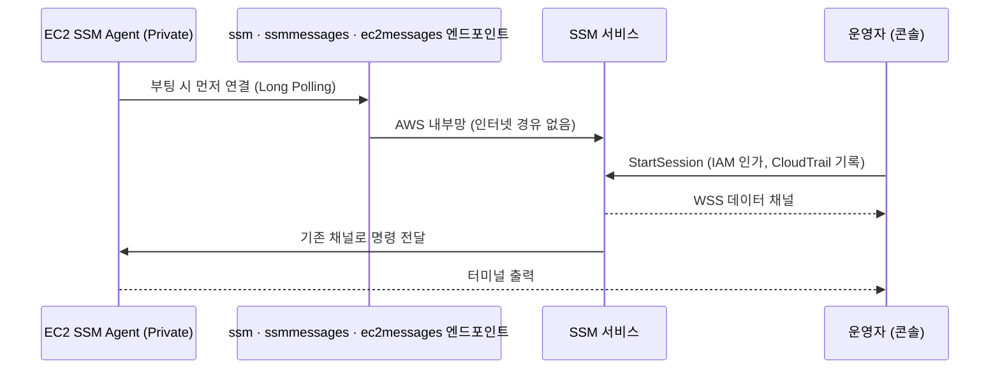

# 02. 보안 설계 — 3개의 관문과 운영 접속

[← README로](../README.md)

## 1. 다층 방어 — 바깥은 넓게, 안쪽은 좁게

요청은 서버에 닿기 전에 성격이 다른 세 관문을 차례로 지납니다. 한 겹이 뚫려도 다음 겹이 막도록 역할을 나눴습니다.

| 관문 | 계층 | 단위 | 성격 | 이 프로젝트에서 |
|---|---|---|---|---|
| ① AWS WAF | L7 | Public ALB | 요청 내용 검사 | SQLi · XSS · 알려진 악성 입력 · 과도 요청 |
| ② NACL | L3–4 | 서브넷(티어) | Stateless | 티어 예약 대역 단위로 경계 통제 |
| ③ 보안그룹 | L3–4 | 인스턴스 | Stateful | 앞뒤 계층 보안그룹만 참조하는 체인 |

## 2. 보안그룹 참조 체인 — 아웃바운드까지 제한

보안그룹은 보통 아웃바운드를 전체 허용으로 둡니다. 이 프로젝트에서는 트래픽이 지나가는 계층(Public ALB → WEB → 내부 ALB → WAS)마다
**"다음 계층 보안그룹의 지정 포트로만 나갈 수 있게"** 아웃바운드도 묶었습니다.

| 보안그룹 | 인바운드 | 아웃바운드 |
|---|---|---|
| ELB-Pub-SG | 0.0.0.0/0 :80, :443 | → WEB-SG :80 |
| WEB-SG | ← ELB-Pub-SG :80 | → ELB-Priv-SG :8080, VPCE-SG :443 |
| ELB-Priv-SG | ← WEB-SG :8080 | → WAS-SG :8080 |
| WAS-SG | ← ELB-Priv-SG :8080 | → DB-SG :3309, Redis-SG :6379, VPCE-SG :443 |
| DB-SG | ← WAS-SG :3309 | 기본값 (말단) |
| Redis-SG | ← WAS-SG · WEB-SG :6379 | 기본값 (말단) |
| VPCE-SG | ← WEB · WAS · 모니터링 :443 | 기본값 (말단) |

- 각 관문이 IP 대역이 아니라 **바로 앞 계층의 보안그룹**을 기준으로 열려 있어, WEB 서버가 침해되더라도 DB 포트로 직접 연결할 수 없습니다.
- WAS는 DB · Redis · 엔드포인트의 지정 포트 외에는 어디로도 연결을 시작할 수 없습니다.
- 말단(DB · Redis · VPCE)은 먼저 연결을 시작하지 않고, 보안그룹은 Stateful이라 응답은 자동으로 허용됩니다.

> 그림은 요청이 지나는 7개 티어만 표시했습니다. 모니터링용 PUBLIC 티어를 포함하면 티어는 8개입니다.

## 3. Bastion 없는 운영 접속 — SSM Session Manager

초기에는 Bastion 호스트와 SSH로 접속하는 방식이었지만, Bastion 자체가 공격 표면이 되고 22번 포트와 SSH 키를 관리해야 했습니다.
그래서 SSM Session Manager로 바꿨습니다.

- **관리용 인바운드 포트 0개.** EC2가 먼저 바깥으로 연결을 걸어 두는 구조라 22번 포트를 열 필요가 없습니다.
- **감사 기록은 두 곳에.** CloudTrail에는 "누가 언제 어떤 인스턴스에 접속했는지", 세션 로그에는 "접속해서 무엇을 실행했는지"가 남습니다.
- **DB 접속.** DB 담당 팀원이 SSM 포트 포워딩으로 로컬 DB 클라이언트에서 프라이빗 RDS에 접속하도록 경로를 설계했습니다.

| 비교 기준 | Bastion + SSH | SSM Session Manager |
|---|---|---|
| 인바운드 포트 | 22 (또는 커스텀 포트) | 없음 |
| 자격증명 | SSH 키 배포 · 회수 | IAM. 비활성화 즉시 차단 |
| 접근 기록 | 별도 구성 필요 | CloudTrail + 세션 로그 |
| 추가 공격 표면 | Bastion 호스트 | 없음 |

## 4. IAM 권한 설계

- **RBAC** — 파트별 IAM 그룹을 만들고 팀원 계정을 넣어 권한을 일괄 부여했습니다.
- **ABAC (설계)** — `ssm:StartSession`을 인스턴스의 `Tier` 태그로 조건화해, 각자 본인 티어 인스턴스에만 접속하도록 정책을 설계했습니다.
- **MFA 강제** — MFA를 등록하기 전에는 대부분의 작업을 막는 정책을 적용했습니다. 이 과정에서 생긴 충돌은 [트러블슈팅](03-troubleshooting.md#2-mfa-강제-정책-때문에-팀원이-로그인-후-막힘)에 정리했습니다.

## 5. AWS WAF — 한도 안에서 고르고, Count로 먼저 관찰

### 규칙 선택

AWS 관리형 규칙 그룹은 용량(WCU)을 소모하고, Web ACL 하나의 기본 한도는 1,500 WCU입니다. 무료 관리형 규칙을 모두 켜면 한도를 넘습니다.
규칙 그룹별 WCU를 직접 조회한 뒤, 앱 특성(Java · DB 연동 · Amazon Linux)에 맞는 조합을 골랐습니다.

| 규칙 그룹 | WCU | 채택 |
|---|---|---|
| Common (OWASP 공통) | 700 | ✅ |
| SQL Injection | 200 | ✅ |
| Known Bad Inputs | 200 | ✅ |
| Linux | 200 | ✅ |
| IP Reputation | 25 | — |
| Anonymous IP | 50 | — |

### 최종 구성 (사용 WCU 1,305)

| 우선순위 | 규칙 | 동작 | 의미 |
|---|---|---|---|
| 0 | Origin 검증 | **Count** | CloudFront가 붙이는 비밀 헤더가 없는 요청 = ALB 직접 호출 **탐지** |
| 1 | Common | Block (본문 크기 제한 하위 규칙만 Count) | OWASP 공통 공격 |
| 2 | SQL Injection | Block | SQL 인젝션 |
| 3 | Known Bad Inputs | Block | Log4Shell 등 알려진 익스플로잇 |
| 4 | Linux | Block | LFI · 경로 탐색 |
| 5 | Rate 제한 | Block | IP당 5분 1,000건 초과 차단. **부하테스트 서버 IP는 예외** |

**운영 원칙**
- 관리형 규칙은 바로 Block하지 않고 **Count로 관찰한 뒤 전환**합니다. Count는 매칭을 기록만 하고 다음 규칙 평가를 계속하는 비종료 동작입니다.
- 로그는 CloudWatch Logs(`aws-waf-logs-` 접두사 필수)로 보냈습니다.
- 보안 규칙과 부하테스트는 충돌하므로, 부하테스트 대역을 예외로 관리했습니다.

## 6. 보안 관측

| 항목 | 구성 | 남기는 것 |
|---|---|---|
| GuardDuty | 활성화 | 위협 탐지 결과 |
| CloudTrail | 멀티리전 + 로그 파일 무결성 검증 | 누가 어떤 API를 호출했는지 |
| VPC Flow Logs | REJECT 트래픽만, CloudWatch Logs | 네트워크 흐름 메타데이터 (패킷 내용은 아님) |
| WAF 로그 | CloudWatch Logs | 규칙별 차단 · 탐지 기록 |

- 중간 점검 시점에는 Flow Logs · GuardDuty가 모두 꺼져 있었습니다. "침해돼도 모르는 상태"를 먼저 없애려고 노력이 적게 드는 순서(GuardDuty → Flow Logs → CloudTrail 점검)로 적용했습니다.
- Flow Logs는 활성 상태였지만 실제로는 로그가 쌓이지 않던 문제를 발견해 고쳤습니다 → [트러블슈팅](03-troubleshooting.md#4-flow-logs가-켜져-있는데-로그가-0바이트)

## 7. 남은 공백

- **CloudFront 우회** — Public ALB 보안그룹이 0.0.0.0/0으로 열려 있어 CloudFront를 거치지 않고 ALB를 직접 호출할 수 있었습니다. Origin 검증 규칙이 Count라 탐지만 했습니다. 다음 단계는 ALB 보안그룹을 CloudFront 관리형 프리픽스 리스트로 제한하는 것이었습니다.
- **AWS Config와 엣지 WAF**는 구축하지 못했고, 발표에서 확장 과제로 밝혔습니다.
- **ABAC 정책**은 설계와 팀원별 접근 표까지 만들었지만, 다른 티어 접속이 실제로 거부되는지 테스트한 기록은 남기지 못했습니다.
